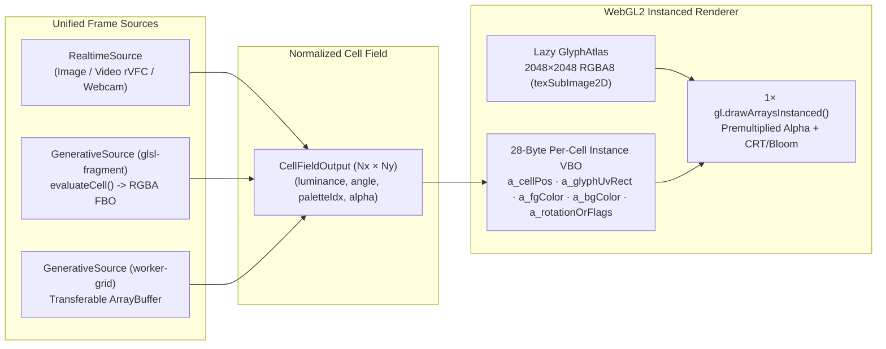

# ASCII Studio

An open-source, 100% client-side **WebGL2 & Web Worker** ASCII Studio for real-time media-to-ASCII rendering and procedural generative ASCII art—built with Next.js (App Router), TypeScript, and Tailwind CSS for zero-overhead static/edge deployment on Vercel.

## Architecture Highlights

- **100% Client-Side Dual-Engine Pipeline:** Zero server-side inference or API costs. Both **Real-Time Media** (images, `requestVideoFrameCallback`-gated video, webcam) and **Procedural Generative** styles (WebGL2 `#version 300 es` fragment fields + Web Worker PDE simulations) run entirely in the browser.
- **Instanced Glyph Atlas Batcher:** Lazily rasterizes monospace ASCII, directional stroke (`| - / \`), and Unicode Braille (`U+2800..U+28FF`) glyphs into a premultiplied $2048 \times 2048$ `RGBA8` texture atlas and renders **100,000+ cells** in a single `gl.drawArraysInstanced` call using a **28-byte per-cell stride**.
- **Decoupled 60 FPS Scheduling:** Engine state lives outside React (`useSyncExternalStore` with `rAF`-coalesced UI updates), running demand-driven renders for static/paused inputs and monotonic-token `rAF` loops for live streams and animations.



## Quickstart

```bash
npm install
npm run dev
```

Open `http://localhost:3000` in a WebGL2-capable browser.

### Verification Commands

```bash
npm run typecheck   # Strict TypeScript check (tsc --noEmit)
npm test            # Vitest unit suite (schemas, Sobel, Braille, Gray-Scott)
npm run build       # Static production build (next build -> out/)
```

## Keyboard Shortcuts

| Shortcut | Action |
| :--- | :--- |
| `Space` | Play / Pause simulation or video playback |
| `Cmd / Ctrl + E` | Open / Close Export dialog |
| `1` – `9` | Quick-switch registered Real-Time & Generative styles |
| Double-click slider | Reset parameter to plugin schema `default` |

## Supported Export Formats

| Format | Exporter | Capabilities |
| :--- | :--- | :--- |
| `.txt` | `TextAnsiExporter` | Clean UTF-8 grid preserving trailing spaces & exact `cols × rows` |
| `.ans` | `TextAnsiExporter` | 24-bit Truecolor ANSI SGR with run-length color deduplication |
| `.svg` | `SvgVectorExporter` | Standalone vector SVG with run-length merged background `<rect>`s |
| `.png` | `MediaCaptureExporter` | Deterministic `1×` / `2×` / `4×` high-DPI raster snapshot |
| `.webm` / `.mp4` | `MediaCaptureExporter` | Real-time `canvas.captureStream(fps)` + `MediaRecorder` capture |

## Clean-Room & Attribution Notice

ASCII Studio is an independent, **MIT-licensed** clean-room implementation inspired by real-time terminal aesthetics, classical signal-processing literature (ITU-R BT.709, Sobel 1968, Bayer 1973, Gray–Scott reaction–diffusion), and open web graphics standards. See [`CLEAN_ROOM_GUIDELINES.md`](./CLEAN_ROOM_GUIDELINES.md) and [`docs/architecture/`](./docs/architecture/) for architectural specifications and licensing rules.
