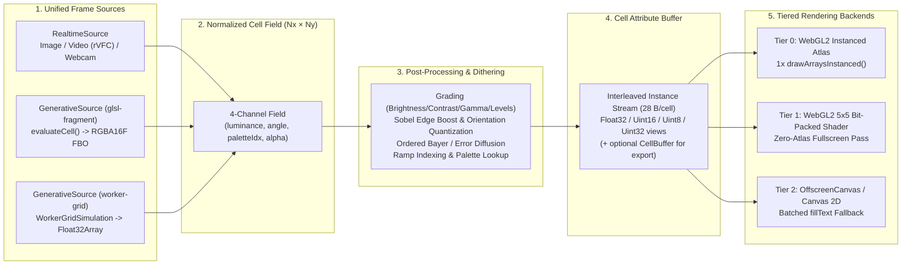

# ASCII Studio Engine v1 — Phase 2 Build Blueprint

**Status:** Phase 2 Implementation Specification  
**Inputs:** [`realtime-pipeline.md`](./realtime-pipeline.md), [`generative-taxonomy.md`](./generative-taxonomy.md), [`src/registry/types.ts`](../../src/registry/types.ts)  
**Compliance:** Clean-room specification governed by [`CLEAN_ROOM_GUIDELINES.md`](../../CLEAN_ROOM_GUIDELINES.md).

---

## 1. Unified `AsciiRenderer` Architecture

`AsciiRenderer` (`src/engine/core/asciiRenderer.ts`) decouples **signal production** from **post-processing, cell quantization, and glyph rasterization**. Both `RealtimeSource` and `GenerativeSource` produce a standardized grid representation $(N_x \times N_y)$ that converges on the exact same downstream pipeline:



### 1.1 Source Convergence Contract

Every frame source implements a common `FrameSource` interface returning a `CellFieldFrame`:

- **`RealtimeSource` (`src/engine/realtime/realtimeSource.ts`):**
  - Accepts `HTMLImageElement`, `HTMLVideoElement` (gated by `requestVideoFrameCallback` to skip duplicate frames), `MediaStream` (webcam/screen), or procedural calibration cards.
  - Applies monospace aspect correction ($w_{\text{cell}} = r_{\text{mono}} \cdot h_{\text{cell}}$, $r_{\text{mono}} \in [0.55, 0.60]$) to compute grid dimensions $(N_x, N_y)$ and downsamples the source frame accordingly.
  - Extracts Rec. 709 linear luminance, contrast/gamma/levels grading, and $3 \times 3$ Sobel edge magnitude + orientation $\theta = \operatorname{atan2}(G_y, G_x)$ (via WebGL2 FBO passes or `edgeWorker.ts`).
- **`GenerativeSource` (`src/engine/generative/generativeSource.ts`):**
  - Adapts any `GenerativeStylePlugin` from `src/registry/generatorRegistry.ts`.
  - For `executionMode: 'glsl-fragment'`, binds the `StudioFrame` UBO and invokes `evaluateCell(cellCoord, gridDims, time)` into an $N_x \times N_y$ `RGBA16F` FBO (ping-ponged if `usesPingPong` is `true`).
  - For `executionMode: 'worker-grid'`, steps `WorkerGridSimulation` at `fixedTimestepHz` and transfers/copies the `4 * Nx * Ny` `Float32Array` output.

### 1.2 Post-Processing, Dithering & Cell Attribute Buffer Emission

Both sources feed the shared post-processing and quantization stage:

1. **Tone & Edge Modulation:** Applies global brightness/contrast/gamma/invert, percentile histogram normalization (if enabled), and edge-strength boosting ($Y_{\text{eff}} = \operatorname{clamp}(Y_{\text{norm}} + \kappa E^\alpha w_e, 0, 1)$).
2. **Dithering:** Applies either ordered Bayer $2^n \times 2^n$ thresholding (temporally stable for video and animations) or CPU Floyd–Steinberg / Atkinson error diffusion (for crisp static/print renders), plus optional $2 \times 4$ Braille sub-cell bitmasking.
3. **Ramp & Color Resolution:** Resolves each cell's glyph index (or directional edge override when `supportsDirectionalGlyphs` is active and $E > \tau_e$) and foreground/background RGBA8 colors from the active palette.
4. **Buffer Packing:** Writes the resolved cells directly into the pre-allocated **28-byte-per-cell interleaved instance buffer** (`ArrayBuffer` reused across frames with zero per-frame GC allocations). Cells with `alpha === 0` or space glyphs with transparent backgrounds are culled prior to upload, minimizing vertex shading work.

*(Note: When exporting `.txt`, ANSI truecolor, or `.svg`, `AsciiRenderer` invokes a lightweight `CellBuffer` pass capturing `{ cols, rows, glyphs: Uint32Array, fgRgba: Uint8Array, bgRgba: Uint8Array }` on demand without slowing down the 60 FPS live path.)*

---

## 2. 28-Byte Per-Cell Instance Layout (WebGL2 Batcher)

To render **100,000+ glyphs** at 60 FPS in a single `gl.drawArraysInstanced(gl.TRIANGLE_STRIP, 0, 4, activeCellCount)` call, the instance VBO uses a tight **28-byte stride** (7 × 32-bit words, naturally 4-byte aligned for all attributes on little-endian hosts).

### 2.1 Binary Stride Specification (`28 Bytes / Instance`)

| Byte Offset | Size | Attribute Name | Typed Array View | WebGL2 `vertexAttrib*Pointer` Config | Encoding & Semantics |
| :--- | :--- | :--- | :--- | :--- | :--- |
| `0..7` | 8 B | `a_cellPos` | `Float32Array` (`+0, +1`) | `size=2, FLOAT, normalized=false, stride=28, offset=0` | Cell origin `(xPx, yPx)` in physical canvas pixels (supports sub-pixel parallax/shake). |
| `8..15` | 8 B | `a_glyphUvRect` | `Uint16Array` (`+4..+7`) | `size=4, UNSIGNED_SHORT, normalized=true, stride=28, offset=8` | Normalized atlas UV rect `[u0, v0, uW, vH]` mapped `[0..65535] -> [0.0..1.0]`. |
| `16..19` | 4 B | `a_fgColor` | `Uint8Array` (`+16..+19`) | `size=4, UNSIGNED_BYTE, normalized=true, stride=28, offset=16` | Foreground glyph `RGBA8` `[r, g, b, a]` mapped `[0..255] -> [0.0..1.0]`. |
| `20..23` | 4 B | `a_bgColor` | `Uint8Array` (`+20..+23`) | `size=4, UNSIGNED_BYTE, normalized=true, stride=28, offset=20` | Per-cell background `RGBA8` `[r, g, b, a]` mapped `[0..255] -> [0.0..1.0]`. |
| `24..27` | 4 B | `a_rotationOrFlags` | `Uint32Array` (`+6`) | `vertexAttribIPointer(loc, 1, UNSIGNED_INT, stride=28, offset=24)` | Bit-packed 32-bit control word (see bitfield below). |

### 2.2 `a_rotationOrFlags` Bitfield Packing

- **Bits `0..7` (`angleByte`):** Quantized cell rotation / gradient orientation in $[0, 255]$ mapping to $[-\pi, \pi)$ radians (`angleRad = (float(flags & 0xFFu) / 255.0 - 0.5) * 6.2831853`).
- **Bits `8..15` (`scaleByte`):** Per-cell scale multiplier in $[0, 255]$ mapping to $[0.0, 2.0]$ (`cellScale = float((flags >> 8u) & 0xFFu) / 127.5`).
- **Bit `16` (`FLAG_ROTATE_QUAD`):** Enables local quad rotation around cell center by `angleRad`.
- **Bit `17` (`FLAG_INVERT_GLYPH`):** Inverts sampled glyph alpha (`1.0 - glyphAlpha`) for negative/cutout cells.
- **Bit `18` (`FLAG_EDGE_EMPHASIS`):** Marks cells overridden by Sobel directional edge strokes.
- **Bits `19..31`:** Reserved (`0`).

### 2.3 Instanced Vertex & Premultiplied Fragment Shaders

```glsl
// --- Instanced Glyph Atlas Vertex Shader (#version 300 es) ---
#version 300 es
layout(location = 0) in vec2  a_corner;          // Unit quad [0,0], [1,0], [0,1], [1,1]
layout(location = 1) in vec2  a_cellPos;         // Instanced: divisor = 1
layout(location = 2) in vec4  a_glyphUvRect;     // Instanced: normalized [u0, v0, uW, vH]
layout(location = 3) in vec4  a_fgColor;         // Instanced: normalized RGBA8
layout(location = 4) in vec4  a_bgColor;         // Instanced: normalized RGBA8
layout(location = 5) in uint  a_rotationOrFlags; // Instanced: packed uint32

uniform vec2 u_viewportPx;  // (canvasWidthPx, canvasHeightPx)
uniform vec2 u_cellSizePx;  // (cellWidthPx, cellHeightPx)

out vec2 v_uv;
out vec4 v_fgColor;
out vec4 v_bgColor;
flat out uint v_flags;

void main() {
  float scale = float((a_rotationOrFlags >> 8u) & 0xFFu) / 127.5;
  scale = (scale > 0.0) ? scale : 1.0;

  vec2 localPx = (a_corner - 0.5) * (u_cellSizePx * scale);
  if ((a_rotationOrFlags & (1u << 16u)) != 0u) {
    float angle = (float(a_rotationOrFlags & 0xFFu) / 255.0 - 0.5) * 6.2831853;
    float c = cos(angle);
    float s = sin(angle);
    localPx = vec2(localPx.x * c - localPx.y * s, localPx.x * s + localPx.y * c);
  }

  vec2 worldPx = a_cellPos + 0.5 * u_cellSizePx + localPx;
  vec2 ndc = (worldPx / u_viewportPx) * vec2(2.0, -2.0) + vec2(-1.0, 1.0);

  gl_Position = vec4(ndc, 0.0, 1.0);
  v_uv = a_glyphUvRect.xy + a_corner * a_glyphUvRect.zw;
  v_fgColor = a_fgColor;
  v_bgColor = a_bgColor;
  v_flags = a_rotationOrFlags;
}
```

```glsl
// --- Instanced Glyph Atlas Fragment Shader (#version 300 es) ---
#version 300 es
precision mediump float;

uniform sampler2D u_atlasTex; // RGBA8 premultiplied glyph atlas

in vec2 v_uv;
in vec4 v_fgColor;
in vec4 v_bgColor;
flat in uint v_flags;

out vec4 outColor;

void main() {
  float glyphAlpha = texture(u_atlasTex, v_uv).a;
  if ((v_flags & (1u << 17u)) != 0u) {
    glyphAlpha = 1.0 - glyphAlpha;
  }

  float fgA = v_fgColor.a * glyphAlpha;
  float bgA = v_bgColor.a * (1.0 - fgA);
  vec3 premulRgb = v_fgColor.rgb * fgA + v_bgColor.rgb * bgA;

  outColor = vec4(premulRgb, fgA + bgA);
}
```

Host blend state uses `gl.enable(gl.BLEND)` with `gl.blendFunc(gl.ONE, gl.ONE_MINUS_SRC_ALPHA)` and `gl.pixelStorei(gl.UNPACK_PREMULTIPLY_ALPHA_WEBGL, true)` on atlas upload so antialiased edges never show dark halos.

---

## 3. Device Capability & Fallback Matrix

`src/engine/core/capabilities.ts` probes the client GPU/browser environment once during engine initialization and selects the highest viable rendering tier. All tiers implement the same `RenderBackend` interface.

| Tier | Backend ID | Required Capabilities | Rendering Mechanism | Memory & Draw Cost | Degrades To |
| :--- | :--- | :--- | :--- | :--- | :--- |
| **Tier 0 (Primary)** | `'webgl2-instanced'` | WebGL2 context (`webgl2`), `MAX_TEXTURE_SIZE >= 2048`, `vertexAttribDivisor` & `drawArraysInstanced` | $2048 \times 2048$ lazy `RGBA8` glyph atlas + 28-byte instance VBO (`1` draw call) | ~16 MB atlas VRAM + `28 * N` bytes; **100k+ cells @ 60 FPS** | Tier 1 on atlas/VRAM failure; Tier 2 on context loss |
| **Tier 1 (Low-VRAM / Mobile GPU)** | `'webgl2-bitpacked'` | WebGL2 context (`webgl2`) without `2048px` atlas budget (or software/mobile GPU heuristic) | Fullscreen triangle (`gl.drawArrays(TRIANGLE_STRIP, 0, 4)`) sampling a compact `Nx × Ny` cell texture + inline $5 \times 5$ `uint` bitmask glyphs in shader registers | <1 MB VRAM, zero font atlas rasterization | Tier 2 if WebGL2 fails or `webglcontextlost` is permanent |
| **Tier 2 (Universal Fallback)** | `'canvas2d'` | `OffscreenCanvas` (preferred, worker-eligible) or `HTMLCanvasElement` 2D context | Batched `fillText` / `fillRect` grouped by color string to minimize `Canvas2D` state churn; strided sub-sampling | Zero VRAM allocation; 5k–12k cells interactively | N/A (universal baseline) |

### 3.1 Context Loss & Runtime Degradation Policy

- **Proactive Probes:** Inspect `gl.getParameter(gl.MAX_TEXTURE_SIZE)`, `gl.getExtension('EXT_color_buffer_float')` (optional—falls back to `RGBA8` FBOs for `RealtimeSource` / `GenerativeSource` when missing), and `WEBGL_debug_renderer_info` (to detect software renderers like SwiftShader and clamp maximum cell count or select Tier 1/2 automatically).
- **Reactive Recovery:** Listen for `webglcontextlost` (`e.preventDefault()`) and `webglcontextrestored`. If restoration succeeds, rebuild VAO/VBO, shaders, and re-upload the glyph atlas from the cached `Map<string, AtlasSlot>`; if restoration fails within 1,500 ms, promote Tier 2 (`canvas2d`) transparently so the viewport never stalls on a blank canvas.

---

## 4. Phase 2 Ordered Build Manifest

Implement modules strictly in bottom-up dependency order. Pure engine directories (`src/engine/*`, `src/registry/*`) must contain **zero** React or Next.js imports.

### Stage A — Core Contracts, Capabilities & Pure Math
1. `src/engine/core/types.ts` — `RenderBackend`, `RenderTier`, `CellFieldFrame`, `CellBuffer`, `FrameSource`, `StudioRenderConfig`, `FrameMetrics`.
2. `src/engine/core/capabilities.ts` — WebGL2/OffscreenCanvas probing, `EXT_color_buffer_float` check, tier selection (`webgl2-instanced` | `webgl2-bitpacked` | `canvas2d`).
3. `src/engine/core/math/vec.ts` — Lightweight 2D/3D vector and clamp/lerp utilities.
4. `src/engine/core/math/prng.ts` — Deterministic Mulberry32 / PCG32 seeded PRNG.
5. `src/engine/core/math/color.ts` — sRGB linearization, Rec. 601/709 luminance, contrast/gamma/levels transforms, hex-to-RGBA8 packing.
6. `src/engine/core/math/dither.ts` — Recursive $2^n \times 2^n$ Bayer threshold generator, Floyd–Steinberg / Atkinson CPU error-diffusion kernels, Braille $2 \times 4$ bitmask encoder.

### Stage B — WebGL2 Kernel & Tiered Glyph Backends
7. `src/engine/core/gl/context.ts` — WebGL2 context creation, `webglcontextlost`/`restored` hooks, state helpers.
8. `src/engine/core/gl/program.ts` — `#version 300 es` shader compile/link, UBO binding, uniform location cache.
9. `src/engine/core/gl/framebuffer.ts` — `RGBA16F` / `RGBA8` FBO & ping-pong pair allocator with resize pooling.
10. `src/engine/core/gl/quad.ts` — Unit quad VBO `[0,0..1,1]` and fullscreen triangle VAO.
11. `src/engine/core/atlas/ramps.ts` — Monospace glyph ink-coverage & directional calibration, ramp indexing.
12. `src/engine/core/atlas/glyphAtlas.ts` — Lazy $2048 \times 2048$ offscreen Canvas 2D rasterizer, `Map<string, AtlasSlot>`, normalized `Uint16` UV rect lookup.
13. `src/engine/core/atlas/instancedBatcher.ts` — Tier 0 28-byte `ArrayBuffer` multi-view packer + instanced vertex/fragment shaders + `drawArraysInstanced` flush.
14. `src/engine/core/atlas/bitpackedFallback.ts` — Tier 1 zero-atlas $5 \times 5$ `uint` bitmask shader backend.
15. `src/engine/core/atlas/canvas2dFallback.ts` — Tier 2 `OffscreenCanvas` / `Canvas2D` color-grouped `fillText` backend.

### Stage C — Registry, Ramp/Palette Definitions & Shared GLSL Prelude
16. `src/registry/types.ts` — *(Completed in Phase 1)* Unified `GenerativeStylePlugin` & `UniformControlSchema`.
17. `src/registry/rampRegistry.ts` — Clean-room built-in character ramps (`classic`, `dense`, `minimal`, `blocks`, `box-drawing`, `braille`, `directional`, `binary`).
18. `src/registry/paletteRegistry.ts` — Monochrome, terminal phosphor, duotone, and full-color RGB sampling presets.
19. `src/engine/generative/shaders/prelude.glsl.ts` — Shared `StudioFrame` `std140` UBO, 2D Simplex noise, fBm, and curl helpers.

### Stage D — Realtime & Generative Frame Sources
20. `src/engine/realtime/mediaSource.ts` — Image, Video (`requestVideoFrameCallback`), Webcam `MediaStream`, and procedural test-card adapter.
21. `src/engine/realtime/shaders/preprocess.glsl.ts` — Aspect-corrected downsampling, Rec. 709 luminance, contrast/gamma/levels pass.
22. `src/engine/realtime/shaders/sobel.glsl.ts` — $3 \times 3$ Sobel $G_x, G_y$, magnitude, and $\operatorname{atan2}$ orientation pass.
23. `src/engine/realtime/shaders/dither.glsl.ts` — Ordered Bayer GPU pass.
24. `src/engine/realtime/workers/edgeWorker.ts` — Off-thread Sobel/ridge worker for CPU fallback path.
25. `src/engine/realtime/realtimeSource.ts` — Implements `FrameSource` over media ingestion + GPU/CPU preprocessing.
26. `src/engine/generative/workers/simWorker.ts` — Dedicated Web Worker executing `WorkerGridSimulation` plugins at fixed timestep.
27. `src/engine/generative/generativeSource.ts` — Implements `FrameSource` for both `'glsl-fragment'` and `'worker-grid'` plugins.

### Stage E — Unified Renderer, Exporters & Initial Plugins
28. `src/engine/core/asciiRenderer.ts` — Top-level `AsciiRenderer` orchestrating `FrameSource` -> Post/Dither -> 28-byte buffer -> Tier 0/1/2 backend.
29. `src/engine/core/export/textExporter.ts` — UTF-8 `.txt`, ANSI 24-bit truecolor, and `<pre>` HTML export from `CellBuffer`.
30. `src/engine/core/export/imageExporter.ts` — High-DPI PNG/WebP and crisp vector SVG export.
31. `src/engine/core/export/videoExporter.ts` — Client-side `MediaRecorder` / WebCodecs export with hold protocol.
32. `src/engine/generative/generators/simplexSmoke.ts` — Family 1 (`noise-field`) generator.
33. `src/engine/generative/generators/waveInterference.ts` — Family 2 (`wave-interference`) generator.
34. `src/engine/generative/generators/grayScott.ts` — Family 3 (`reaction-diffusion`) `worker-grid` generator.
35. `src/engine/generative/generators/curlFlow.ts` — Family 4 (`vector-flow`) generator.
36. `src/engine/generative/generators/audioSpectrum.ts` — Family 5 (`audio-spectral`) generator.
37. `src/registry/generatorRegistry.ts` & `src/registry/presetRegistry.ts` — Registered plugins and clean-room presets.

### Stage F — Studio State, Next.js App Router UI & Verification
38. `src/state/studioStore.ts` & `src/state/useAsciiEngine.ts` — External store (`useSyncExternalStore`) + `rAF`-coalesced render/telemetry loop.
39. `src/components/**` & `src/app/**` — Schema-driven inspector, viewport canvas, mode switcher, export modal, static App Router shell.
40. `tests/engine/math.test.ts`, `tests/engine/atlas.test.ts`, `tests/registry/registry.test.ts` — Vitest unit suites for colorimetry, Bayer recursion, PRNG determinism, 28-byte buffer alignment, and registry schema integrity.
